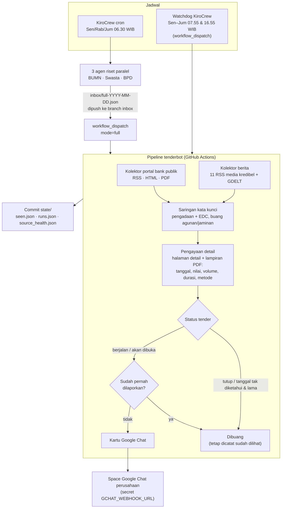

# Tender Bot

Tender Bot memantau tender pengadaan EDC dan managed service EDC di bank-bank Indonesia, lalu melaporkannya ke Space Google Chat perusahaan dua kali setiap hari kerja.

Cakupan: BUMN, bank swasta KBMI 3–4, dan seluruh BPD. Saat ini ada 43 bank di [`data/banks.yaml`](data/banks.yaml).

Yang dilaporkan dan yang tidak:

- Hanya tender yang **masih berjalan** atau **akan segera dibuka**. Tender yang sudah tutup tidak ditampilkan.
- Tender yang sudah pernah dilaporkan tidak dikirim lagi.
- Bila tidak ada yang baru, bot tetap mengirim "Tidak ada informasi tender baru", beserta jumlah bank yang dicek dan daftar sumber yang gagal diakses.

Dokumen lain:

- Desain teknis: [docs/DESIGN.md](docs/DESIGN.md)
- Daftar pendaftaran vendor per bank: [docs/registrasi-vendor.md](docs/registrasi-vendor.md)
- Riset awal: [kerja/riset/riset-eproc-bank-edc.md](kerja/riset/riset-eproc-bank-edc.md), dengan versi PDF di [kerja/laporan/](kerja/laporan/laporan-riset-eproc-bank-edc.pdf)

---

## 1. Cara kerja bot

Bot berjalan dalam dua mode:

| Mode | Kapan (WIB) | Dijalankan oleh | Isi |
|---|---|---|---|
| **Riset penuh** (`full`) | Senin, Rabu, Jumat 06.30 | Agen AI KiroCrew di laptop yang menyala 24/7 | Tiga agen riset paralel (BUMN / swasta / BPD) membaca portal, membuka situs yang butuh browser, dan mencari berita, lalu digabung dengan riset ringan |
| **Riset ringan** (`light`) | Senin–Jumat 07.55 dan 16.55 | Dipicu watchdog KiroCrew di laptop, dijalankan GitHub Actions | Kolektor otomatis dengan saringan kata kunci, tanpa AI |

Akhir pekan dan libur nasional ([`data/holidays.yaml`](data/holidays.yaml)) dilewati.

Cron bawaan GitHub Actions tidak dipakai. Pada uji 26 Oktober 2026, jadwal pagi baru jalan 4,5 jam terlambat dan jadwal sore tidak jalan sama sekali. Karena itu semua run dipicu dari laptop lewat `workflow_dispatch`.

Setiap selesai run, watchdog mengirim **laporan detail** ke Telegram. Isinya data lengkap tender, item yang dibuang, dan sumber yang gagal. Space Google Chat hanya menerima ringkasan singkat untuk tim bisnis.

Watchdog pagi pada Senin, Rabu, dan Jumat juga berfungsi sebagai **cadangan**:

- Bila riset penuh hari itu sudah tercatat, watchdog hanya meneruskan laporannya ke Telegram.
- Bila riset penuh belum tercatat, misalnya karena gagal, watchdog menjalankan riset ringan. Pesannya diberi catatan "riset penuh tidak berjalan hari ini".

### Diagram alur



### Langkah per run

1. **Kumpulkan** kandidat dari dua jenis sumber:
   - Portal bank yang daftar tendernya terbuka tanpa login, misalnya arsip pengadaan Bank Sumut dan halaman Lelang Pengadaan Bank Jatim.
   - Berita dari 11 feed RSS media kredibel (Detik, CNBC Indonesia, Kontan, Katadata, Antara, Tempo, IDX Channel, CNN Indonesia) dan dari [GDELT DOC 2.0 API](https://api.gdeltproject.org/api/v2/doc/doc).

   Aturan akses: setiap request punya timeout 20 detik dan retry satu kali, dan `robots.txt` selalu dipatuhi. Halaman yang memblokir bot (HTTP 403, "Request Rejected", Incapsula) dicatat sebagai gagal akses dan tidak diakali.
2. **Saring.** Item harus memuat kata pengadaan (tender, pengadaan, sewa, sewa beli, pemeliharaan, managed service) sekaligus kata EDC (mesin EDC, Smart EDC, EDC Android, Electronic Data Capture). Item tentang lelang agunan/jaminan dan "EDC" dalam arti lain (misalnya Export Development Canada) dibuang.
3. **Perkaya.** Bot membuka halaman detail dan lampiran PDF untuk mengambil tanggal posting, tanggal buka–tutup pendaftaran, batas penawaran, nilai/HPS, volume, durasi kontrak, metode pengadaan, tempat daftar, dan kontak. Data yang tidak tertulis di sumber dibiarkan kosong dan tidak ditampilkan. Bot tidak menebak.
4. **Tentukan status.** Status dihitung dari tanggal hari ini (WIB):
   - *akan dibuka*: tanggal buka pendaftaran setelah hari ini.
   - *berjalan*: hari ini masih di antara tanggal buka dan tanggal tutup.
   - *tutup*: tanggal tutup sudah lewat. Item dibuang.

   Bila tanggal tutup tidak diketahui, item hanya dikirim jika diposting dalam 45 hari terakhir.
5. **Dedup.** Setiap tender diberi sidik `sha256(bank + judul dinormalisasi + url)`, disimpan di `state/seen.json`. Tender yang sama tidak dikirim dua kali.
6. **Laporkan.** Bot mengirim satu kartu per tender: bank, judul, status, tanggal, nilai, volume, durasi, metode, tempat daftar, kontak, tombol **Buka sumber** dan **Lampiran**.
7. **Simpan state.** Workflow meng-commit folder `state/` ke `main`. Bila pengiriman gagal, job berwarna merah dan state tidak disimpan, jadi tender itu dicoba lagi di run berikutnya.

---

## 2. Cara riset dilakukan

### Riset penuh (agen AI KiroCrew)

- Tiga agen riset ("Yang ngeriset") bekerja paralel, masing-masing satu kelompok bank: BUMN + swasta, BPD barat, dan BPD timur. Satu agen per kelompok mencegah satu situs yang macet menahan seluruh riset.
- Alat utama: pencarian web dan pengambilan halaman. Untuk situs yang isinya dimuat JavaScript (bank bjb, Bank Jateng, Bank Kalbar), agen memakai browser Playwright dengan batas waktu keras 60 detik per perintah.
- Berita hanya dari media kredibel. Sumber lain tetap dicatat tetapi diberi label *sumber belum terverifikasi*.
- Setiap item wajib punya URL sumber yang benar-benar dibuka. Field yang tidak diketahui diisi `null`.
- Hasil ditulis bertahap ke satu file JSON. Bila satu agen macet, temuan agen lain tetap aman.

### Aturan bukti yang dipakai sejak riset awal

Setiap fakta di file riset diberi label asal buktinya:

| Label | Arti |
|---|---|
| `[PORTAL]` | Dibaca langsung dari situs atau portal resmi bank |
| `[KOORDINATOR]` | Dicek ulang langsung oleh koordinator |
| `[BERITA]` | Dari artikel media yang dibuka penuh |
| `[SNIPPET]` | Hanya dari cuplikan hasil pencarian; halaman aslinya tidak terbuka |
| `[INFERENSI]` | Kesimpulan peneliti, bukan fakta tertulis |
| `[TERBATAS]` | Halaman dicoba dibuka tetapi tidak terbaca (JavaScript, diblokir, atau butuh login) |

"Tidak ditemukan" berarti tidak ketemu dalam batas riset, bukan bukti bahwa portal atau tendernya tidak ada.

### Yang tidak dilakukan bot

- Tidak login ke portal mana pun, tidak mendaftar akun, dan tidak mengisi formulir.
- Tidak mengakali `robots.txt`, CAPTCHA, atau blokir WAF. Sebagai contoh, Google News RSS tidak dipakai karena `robots.txt` news.google.com melarang `/rss/search`.

### Keterbatasan yang perlu diketahui

- Tender EDC bank besar (BRI, Mandiri, BNI, BCA, dan lainnya) umumnya tidak diumumkan publik. Tender seperti ini lewat portal vendor yang wajib login atau lewat undangan. Bot hanya bisa melihatnya lewat berita, atau nanti lewat email undangan setelah perusahaan terdaftar sebagai vendor (rencana tahap 8: pembaca Gmail).
- Dari server GitHub, beberapa feed (CNBC, Kontan Investasi, CNN) kadang menolak akses (HTTP 403), dan GDELT bisa membatasi laju (HTTP 429). Kegagalan ini dicatat di laporan.
- Riset ringan memakai kata kunci, sehingga tender dengan judul yang tidak memuat kata kunci bisa terlewat sampai riset penuh berikutnya.

---

## 3. Bank yang perlu login (pendaftaran vendor)

Daftar lengkap beserta syarat dan kontak ada di [docs/registrasi-vendor.md](docs/registrasi-vendor.md). Data per 23 Oktober 2026.

### Bisa daftar online sekarang

Setelah akun aktif, tender di dalam portal hanya terlihat setelah login.

| Bank | Halaman daftar | Catatan |
|---|---|---|
| Bank Jatim | [eprocurement.bankjatim.co.id](https://eprocurement.bankjatim.co.id/main/index/registrasi) | NPWP + email resmi perusahaan, lalu aktivasi lewat email. Kontak vendormanagement@bankjatim.co.id |
| Bank Sumsel Babel | [eproc.banksumselbabel.com](https://eproc.banksumselbabel.com/index.php/homepage/register.shtml) | Dokumen: NIB, NPWP, SPPKP, akta, SPT 1771, neraca, bukti pengalaman, daftar peralatan. Keanggotaan gugur bila 2 tahun tidak ikut lelang |
| Bank Sulselbar | [eproc.banksulselbar.co.id](https://eproc.banksulselbar.co.id/register) | Wajib terdaftar sebelum ikut tender. Dokumen: akta, NIB, NPWP + PKP, laporan keuangan 2 tahun |
| Bank Sultra | [e-tender.banksultra.co.id](https://e-tender.banksultra.co.id/auth/register) | Akun aktif setelah direktur membawa dokumen asli ke kantor Kendari |
| SMBC Indonesia | [eprocsmbci.pengadaan.com](https://eprocsmbci.pengadaan.com/index.php/registrasi) | Login dengan akun vendor.pengadaan.com |
| Bank Sulteng | [eproc.banksulteng.co.id](https://eproc.banksulteng.co.id/#/daftar) | Konfirmasi dulu ke bank: kode halamannya berlabel "UAT" |

### Wajib login, syarat belum terbaca (perlu dibuka manual di browser)

| Bank | Portal | Catatan |
|---|---|---|
| BRI | [tdronline.bri.co.id](https://tdronline.bri.co.id/) → [eproc.bri.co.id](https://eproc.bri.co.id/) | Daftar akun di tdronline, lalu login di eproc |
| BTN | [e2eprocreg.btn.co.id](https://e2eprocreg.btn.co.id/) | Login Oracle EBS. Helpdesk WA +62 822 5888 2676, helpdesk.e2eproc@btn.co.id |
| BSI | [rekanan.bankbsi.co.id](https://rekanan.bankbsi.co.id/) | Portal aktif; fungsinya baru disimpulkan dari nama alamat |
| BNI | [e-proc.bni.co.id](https://e-proc.bni.co.id/) | Saat dicek menjawab "tidak tersedia" (HTTP 503) |
| bank bjb | [eproc.bankbjb.co.id](https://eproc.bankbjb.co.id/) | Ada menu pendaftaran di aplikasi |

### Daftar per tender, tanpa database vendor tetap

| Bank | Cara |
|---|---|
| Bank Sumut | Datang langsung ke kantor pusat Medan untuk setiap tender. Kontak 061-4155100 ext. 1623 |
| BPD Bali | Email atau datang langsung; pgn.uma@bpdbali.co.id |
| Bank NTB Syariah | Email + surat minat bermeterai |
| Bankaltimtara | Kirim formulir ke tender@bankaltimtara.co.id |
| Bank Papua | Datang langsung ke kantor pusat Jayapura |

### Portal tidak ditemukan: tanyakan ke bagian pengadaan

- Bank swasta: Bank Mandiri, BCA, CIMB Niaga, PermataBank, Maybank Indonesia, OCBC Indonesia, Panin, Bank Mega, UOB Indonesia, Danamon.
- BPD: Bank Aceh Syariah, Bank Bengkulu, Bank Lampung, Bank Jateng, Bank Banten, Bank Nagari, Bank Jambi, BPD DIY, Bank Kalsel, Bank Kalteng, Bank Maluku Malut.

---

## 4. Menjalankan dan menguji

Uji coba (dry-run) mencetak pesan ke log tanpa mengirim ke Google Chat dan tanpa menyimpan state.

Lewat GitHub Actions:

```bash
gh workflow run tender-bot.yml -f mode=light -f dry_run=true
```

Secara lokal (Python 3.12):

```bash
pip install -r requirements.txt
python -m tenderbot run --mode light --dry-run
```

Opsi yang berguna saat menguji:

- `--today YYYY-MM-DD`: memaksa tanggal. Tanpa opsi ini, tanggal dihitung dalam WIB.
- `--state-dir PATH`: memakai folder state lain, supaya `state/` di repo tidak berubah.
- `--fallback-full-check`: mengaktifkan logika cadangan Senin/Rabu/Jumat.
- `--mode full --inbox path/ke/full-YYYY-MM-DD.json`: menjalankan mode full dari file inbox.

Unit test: `python -m pytest -q`. Semua uji memakai fixture lokal, tanpa internet.

## 5. Struktur repo

```
.github/workflows/tender-bot.yml   jadwal + dispatch GitHub Actions
src/tenderbot/                     kode bot (kolektor, saringan, pengayaan, status, dedup, Google Chat)
data/banks.yaml                    daftar bank, akses, sumber
data/keywords.yaml                 kata kunci, kata buang, media kredibel
data/news_feeds.yaml               feed RSS media yang sudah diverifikasi
data/holidays.yaml                 libur nasional + cuti bersama
state/                             seen.json, runs.json, source_health.json (di-commit oleh workflow)
docs/                              desain + daftar registrasi vendor
kerja/riset/                       hasil riset dengan label bukti
tests/                             unit test + fixture
```

## 6. Keamanan

- Repo ini publik. URL webhook Google Chat hanya ada di secret repo `GCHAT_WEBHOOK_URL`, tidak pernah ditulis ke file atau dicetak ke log.
- `state/` hanya berisi data tender yang memang publik.
- Bila URL webhook pernah tersebar, buat webhook baru di Space (Apps & integrations → Webhooks), lalu perbarui secret di Settings → Secrets and variables → Actions.
